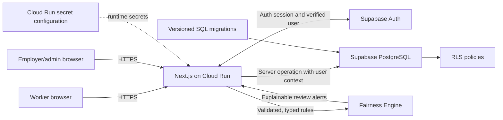

# FairShift Architecture

Status: source implementation present; service integration pending. Implemented: Next.js app shell, Supabase browser/server factories, auth actions and guards, worker/management data routes, migrations/RLS source, fairness rules, response headers, health route, and Cloud Run container. No Supabase instance or Cloud Run service is connected, so database and deployment behavior remain unverified.

## Components

- **Next.js App Router + TypeScript:** responsive worker and management interfaces; server components, server actions, or route handlers for trusted operations.
- **Supabase Auth:** authenticated identity and session cookies via `@supabase/ssr`.
- **Supabase PostgreSQL:** persistent profiles, organizations/sites, shifts, attendance, wage rules/records, safety reports, and status history.
- **RLS:** database-enforced tenant, role, and record ownership boundaries, in addition to server authorization.
- **SQL migrations:** ordered, version-controlled schema, constraints, indexes, grants, and policies.
- **Google Cloud Run:** one containerized Next.js web service. Supabase remains the managed identity/database provider.

Avoid microservices and separate queues until measured requirements justify them. Never use in-memory or browser-only data as the source of truth for important records.

## Architecture diagram

## Representative request/data flow

1. A user signs in through Supabase Auth; the session is managed using secure cookies appropriate to the production environment.
2. A Next.js server action or route handler validates the request, resolves the authenticated user, and checks the profile role and organization membership.
3. The server performs the operation using the user's session context and least-privilege database access. PostgreSQL RLS independently applies ownership and organization rules.
4. Database constraints enforce valid references and permitted state. The server returns a typed, minimal result; it does not send unrelated private records to the browser.
5. For review alerts, trusted server logic reads authorized records, evaluates deterministic configured rules, and returns evidence and a human follow-up suggestion. Alerts never make employment decisions.

## Boundaries and operations

Public browser configuration may contain the Supabase URL and publishable key. The service-role credential, if a specifically justified server operation ever requires it, must remain server-only and be supplied by Cloud Run secret configuration. Prefer user-scoped operations with RLS.

Cloud Run instances are stateless: local filesystem and process memory are not durable storage. PostgreSQL is the persistence layer. Environment variables, startup/port contract, health verification, and deploy procedure are specified in [DEPLOYMENT.md](DEPLOYMENT.md).

## Planned versus implemented

The current workspace includes app routes, validated Supabase clients, versioned schema/RLS source, auth flows, and `GET /api/health`. No Supabase account, applied schema, Cloud Run service, or production URL is configured.

Public Supabase configuration is inlined into the browser bundle at build time. The same values must be supplied to the image build and the runtime; see [DECISIONS.md](DECISIONS.md) ADR-002 and [DEPLOYMENT.md](DEPLOYMENT.md).

Related: [database design](DATABASE_SCHEMA.md), [security](SECURITY.md), [API contracts](API_CONTRACTS.md), [decisions](DECISIONS.md).
